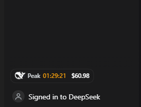

# dsh-balance-whale

<p align="center">
  
  &nbsp;&nbsp;
  
</p>

A whale in the DSH sidebar footer that shows your DeepSeek account balance, a live countdown to the
next price switch, and whether you are on peak or off-peak pricing.

- **Peak** — the whale is drawn bright and tilted, and the countdown runs in the peak colour.
- **Off-peak** — the whale is drawn pale and curled, and the countdown runs in the off-peak colour.
- A live `HH:MM:SS` between the whale and the balance counts down to the next switch, and the whale
  changes pose the moment it reaches zero.
- The balance refreshes **by itself** every 30 seconds, and immediately when the window regains
  focus or the page becomes visible. Nothing to click.

The screenshots above are stills. In the running app the whale moves: it bobs and turns while the
price is at peak, and breathes slowly while it sleeps off-peak.

Hover the chip for the full picture: the price multiplier, the clock time of the next switch, the
recharge/bonus split, and how long ago the number was read.

## Install

From the [plugin market](https://dshmarket.com/) once listed, or directly:

```sh
dsh plugin --profile web add github:tespio/dsh-balance-whale
```

Prebuilt tarball, pinned to a release:

```sh
dsh plugin --profile web add https://github.com/tespio/dsh-balance-whale/releases/download/v1.1.0/dsh-balance-whale-1.1.0.tgz
```

There is no build step and there are no dependencies — the package is plain JavaScript, so
installing it never asks you to approve build scripts. After a page refresh the chip appears beside
Settings in the sidebar footer.

Requires a DSH build where you are signed in to a DeepSeek account (Settings → Account). Without a
signed-in account the chip shows `—` and says so in its tooltip.

## How it works

- **Host half** (`index.js`) reads the signed-in account's Platform wallets through the harness
  account service and serves them as JSON on one loopback route, `/plugin/deepseek-balance`, cached
  for 10 seconds. The browser never receives a credential.
- **Client half** (`client.js`) registers a chip in the `sidebar.footer.action` slot, polls that
  route, and draws the whale inline as SVG. Styles use the host's `--dsw-alias-*` theme tokens, so
  it follows light and dark themes.

A failed read never blanks the number: the last good balance stays on screen while the next attempt
runs, retrying at 4s, 8s and 16s before settling back to the 30-second cadence.

## Pricing rule

Peak is **Monday–Friday 09:00–12:00 and 14:00–18:00 Beijing time** (UTC+8), with half-open ranges
(12:00 sharp is already off-peak). Everything else is off-peak at half price, and weekends plus
Chinese public holidays are off-peak all day. The rule and the whale artwork come from
[DeepSeek Status](https://github.com/tespio/DeepSeekStatus).

The switch is computed in the browser and re-armed exactly on the boundary, so the whale changes
pose on the minute rather than up to a poll late.

## Privacy

- No telemetry, no analytics. The only network request is the balance read the host performs through
  your existing Platform sign-in.
- The route returns wallet totals and timestamps only, is served from the same origin, and sends no
  CORS header, so other sites cannot read it.

## Notes

- The whale is the DeepSeek mark, taken from the [Simple Icons](https://simpleicons.org) collection
  (CC0). "DeepSeek" and its logo belong to their owner; this is an unofficial widget.
- The Chinese public-holiday calendar is embedded (2025–2026). A new year needs a new release.

## License

MIT
